# RAG Génie Civil

**Evaluation of a Hierarchical RAG Architecture Applied to Civil Engineering Standards**

A research project comparing hierarchical and flat-window retrieval strategies for question answering over Eurocode 2 (NF EN 1992-1-1:2004), evaluated across four large language models using RAGAS metrics with a clause-level hallucination guardrail.

[](https://www.python.org/)
[](LICENSE)
[](https://www.trychroma.com/)
[](https://huggingface.co/sentence-transformers/all-MiniLM-L6-v2)
[](https://groq.com/)

---

## Table of Contents

1. [Overview](#overview)
2. [Research Objectives](#research-objectives)
3. [Architecture](#architecture)
4. [Retrieval Strategies](#retrieval-strategies)
5. [Technology Stack](#technology-stack)
6. [Repository Structure](#repository-structure)
7. [Installation and Setup](#installation-and-setup)
8. [Usage](#usage)
9. [Evaluation and Results](#evaluation-and-results)
10. [Limitations and Future Work](#limitations-and-future-work)
11. [Research Context](#research-context)
12. [License and Disclaimer](#license-and-disclaimer)

---

## Overview

Structural engineers consult normative standards like Eurocode 2 and ACI 318 constantly — to verify cover requirements, check partial safety factors, confirm minimum reinforcement ratios. These standards are dense, cross-referential, and safety-critical.

Conventional RAG pipelines chunk documents using fixed token windows without regard for document structure. Applied to Eurocode 2, this produces problematic splits: a formula is retrieved without the applicability condition that immediately follows it; a NOTE containing a national annex value ends up in a different chunk from the clause it modifies; a table row is embedded without its column headers.

This project tests a different approach: **respect the document's native hierarchy during chunking**. One chunk equals one complete clause with all of its direct child paragraphs, notes, and table data. The full ancestor path (`Section 4 > 4.4 > 4.4.1.2`) is prepended to the chunk text so the embedding captures structural location alongside content.

The core comparison is controlled:

| Strategy | Description |
|----------|-------------|
| **Hierarchical** | One chunk = complete clause + all direct children, ancestor path prepended |
| **Flat (baseline)** | Fixed 512-token sliding window, no structure awareness |
| **Parent-child** | Fine-grained child chunks retrieved, full parent clause used for generation |

Both pipelines use the same embedding model, the same LLM, and the same corpus. Any measured difference in answer quality is attributable to the chunking strategy.

---

## Research Objectives

1. Does clause-boundary chunking outperform fixed-window chunking on precise technical lookup tasks (cover values, safety factors, formula parameters)?
2. Does the parent-child small-to-big pattern improve answer completeness compared with direct hierarchical retrieval?
3. What hallucination rate do current LLMs achieve on a clause-citation task when constrained by retrieved context?
4. How do four LLMs of different sizes (20B to 120B parameters) compare on the same retrieval corpus and prompt?

---

## Architecture

```mermaid
flowchart TD
    PDF[("📄 EC2 PDF\nNF EN 1992-1-1:2004")]

    subgraph PARSE["1 · Parsing (standards_parser.py)"]
        P1["Font-size + bold\nheading detection"]
        P2["2,100+ Node objects\n(section / clause / paragraph / note)"]
        P3["Cross-reference\nextraction (~569 refs)"]
    end

    subgraph CHUNK["2 · Chunking (3 strategies)"]
        C1["Hierarchical\nhierarchical_chunker.py\n467 chunks"]
        C2["Flat baseline\nflat_chunker.py\n315 chunks"]
        C3["Parent-child\nparent_child_chunker.py\n1818 children\n313 parents"]
    end

    subgraph INDEX["3 · Indexing (indexer.py + chroma_client.py)"]
        I1["all-MiniLM-L6-v2\nembeddings"]
        I2["ChromaDB\n3 collections:\nec2_hierarchical\nec2_flat\nec2_child"]
    end

    subgraph RETRIEVE["4 · Retrieval (hybrid_retriever.py)"]
        R1["Child vector search\n+ BM25 (French stem)"]
        R2["Reciprocal Rank\nFusion (k=60)"]
        R3["Cross-encoder\nreranking"]
        R4["Table router\n+ Symbol dict\n+ Formula library"]
    end

    subgraph GENERATE["5 · Generation (multi_model_generation.py)"]
        G1["Groq\ngpt-oss-120b"]
        G2["Gemini\ngemini-2.5-flash"]
        G3["NVIDIA\nllama-3.1-70b"]
    end

    subgraph EVAL["6 · Evaluation"]
        E1["RAGAS\n4 metrics"]
        E2["Hallucination guard\nclause-level check"]
        E3["50-question\nbenchmark"]
    end

    PDF --> PARSE
    PARSE --> CHUNK
    CHUNK --> INDEX
    INDEX --> RETRIEVE
    RETRIEVE --> GENERATE
    GENERATE --> EVAL
```



---

## Retrieval Strategies

### Flat retrieval (baseline)

The PDF text is concatenated page-by-page, stripped of headers/footers, then sliced into overlapping 512-token windows. Each window is embedded and stored in ChromaDB. Retrieval is pure vector cosine similarity.

Weakness: a window routinely spans two or three different clauses, so the embedding signal is diluted. Formula images, applicability conditions, and notes are frequently split from each other.

### Hierarchical retrieval

The parser identifies clause boundaries by font size and bold flags. Each clause (or subclause) becomes one chunk together with all of its direct child content. The ancestor path is prepended to the chunk text. BM25 (rank-bm25, French Snowball stemmer) is run in parallel and fused with vector results using Reciprocal Rank Fusion.

Strength: every chunk is semantically coherent — it represents one complete normative requirement.

### Parent-child retrieval

Fine-grained child chunks (one paragraph or one table row, ≤200 tokens) are indexed for precise embedding retrieval. After retrieval, each child is replaced by its parent chunk (the full clause, ≤1500 tokens) which is what the LLM actually reads.

Strength: the embedding operates on focused text; the LLM reads the full clause context.

### Enrichment layers

On top of whichever base strategy is used, the pipeline applies:

- **Query rewriter** (`query_rewriter.py`): expands technical queries with EC2 symbols and clause numbers, optionally calling a lightweight LLM for complex reformulations
- **Symbol dictionary** (`symbol_dictionary.py`): detects EC2 symbols in the query (γc, fyd, εcu2, …) and injects their definitions as a context chunk
- **Table router** (`table_router.py`): intercepts direct numeric lookups (cover for XC2 × S4, partial safety factors, concrete class properties) and answers from pre-built dicts instead of relying on embedding retrieval
- **Formula library** (`formula_library.py`): injects the full formula text for clauses with image-rendered equations
- **Cross-encoder reranker** (`reranker.py`): `ms-marco-MiniLM-L-6-v2` rescores (query, chunk) pairs after hybrid retrieval and reorders the top-8

---

## Technology Stack

| Component | Tool | Role |
|-----------|------|------|
| PDF parsing | PyMuPDF (fitz) | Per-span font metadata extraction, heading classification |
| Table extraction | pdfplumber | Line-geometry-based table detection for 5 key tables |
| Vector store | ChromaDB 0.6 | Local persistent storage, 3 named collections |
| Embeddings | sentence-transformers `all-MiniLM-L6-v2` | 22M-param multilingual model |
| BM25 | rank-bm25 | Keyword retrieval with NLTK French Snowball stemmer |
| Cross-encoder | `ms-marco-MiniLM-L-6-v2` | Reranking after hybrid retrieval |
| Token counting | tiktoken (cl100k_base) | Consistent token budget across all chunkers |
| LLM — primary | Groq `openai/gpt-oss-120b` | 500 tokens/s, 131K context |
| LLM — alternative | Google Gemini `gemini-2.5-flash` | 1M context window |
| LLM — alternative | NVIDIA `meta/llama-3.1-70b-instruct` | Via build.nvidia.com |
| Web UI | Flask | Single-page chat interface |
| Evaluation judge | NVIDIA `meta/llama-3.3-70b-instruct` | RAGAS scoring (separate from RAG models) |
| Language | Python 3.10+ | |

---

## Repository Structure

```
rag-genie-civil/
│
├── app.py                      # Flask web interface (python app.py)
├── run_pipeline.py             # Master pipeline runner (parse → index → test)
├── score_all_models.py         # Batch RAGAS evaluation across all models
├── requirements.txt
├── pyproject.toml
├── .env.example                # Environment variable template (copy → .env)
├── LICENSE
│
├── structrag/                  # Core library
│   ├── config.py               # Central configuration (all paths + constants)
│   │
│   ├── parsing/
│   │   ├── hierarchy_schema.py # Node dataclass — shared data model
│   │   ├── standards_parser.py # EC2 PDF → Node list via PyMuPDF
│   │   └── table_extractor.py  # pdfplumber table extraction (5 tables)
│   │
│   ├── chunking/
│   │   ├── hierarchical_chunker.py  # Clause-boundary chunks (main contribution)
│   │   ├── flat_chunker.py          # Sliding-window baseline
│   │   └── parent_child_chunker.py  # Small-to-big chunking + parent lookup
│   │
│   ├── retrieval/
│   │   ├── chroma_client.py    # ChromaDB client + collection management
│   │   ├── indexer.py          # Batch upsert into ChromaDB
│   │   ├── retriever.py        # retrieve_hierarchical / flat / child
│   │   ├── hybrid_retriever.py # BM25 + vector + RRF fusion
│   │   ├── reranker.py         # Cross-encoder reranking
│   │   ├── query_rewriter.py   # Symbol-aware query expansion
│   │   ├── symbol_dictionary.py # EC2 symbol → definition registry
│   │   ├── table_router.py     # Direct numeric table lookups
│   │   ├── formula_library.py  # EC2 formula text by clause number
│   │   └── inject_tables.py    # One-time table injection script
│   │
│   ├── rag_pipeline/
│   │   ├── generation.py           # OpenAI backend + GenerationResult
│   │   ├── groq_generation.py      # Groq backend + domain classifier
│   │   ├── multi_model_generation.py # Unified Groq/Gemini/NVIDIA interface
│   │   └── app.py                  # CLI / REPL entry point
│   │
│   ├── evaluation/
│   │   ├── hallucination_guard.py  # Clause-level citation verification
│   │   ├── qa_benchmark.py         # 50-question benchmark dataset
│   │   ├── ragas_runner.py         # RAGAS pipeline runner
│   │   ├── score_benchmark.py      # Scoring utilities
│   │   └── ragas_comparison.json   # Benchmark results
│   │
│   └── data/
│       └── source_manifest.json    # Document registry
│
├── tests/
│   ├── conftest.py                 # Shared fixtures + pytest markers
│   ├── test_config.py              # Configuration module tests
│   ├── test_hierarchy_schema.py    # Node dataclass + serialisation tests
│   ├── test_chunkers.py            # Hierarchical + parent-child chunker tests
│   ├── test_retrieval_unit.py      # RRF fusion + metadata serialiser tests
│   ├── test_hallucination_guard.py # Hallucination guard tests
│   ├── test_domain_classifier.py   # Domain classifier tests
│   └── rag_eval.py                 # 14-question diagnostic harness (manual run)
│
└── docs/
    ├── architecture.md     # Component map + pipeline diagram
    ├── methodology.md      # Chunking strategies + document parsing details
    └── evaluation.md       # RAGAS metrics + benchmark results
```

---

## Installation and Setup

### Requirements

- Python 3.10 or higher
- A licensed copy of the Eurocode 2 PDF (NF EN 1992-1-1:2004) — not included in this repository
- At least one API key: Groq (free tier), Gemini (free tier), or NVIDIA build

### 1. Clone the repository

```bash
git clone https://github.com/belkadhimanef/rag-genie-civil.git
cd rag-genie-civil
```

### 2. Create a virtual environment

```bash
python -m venv .venv

# Windows
.venv\Scripts\activate

# macOS / Linux
source .venv/bin/activate
```

### 3. Install dependencies

```bash
pip install -r requirements.txt
```

For French stemming support in BM25 (recommended):

```bash
python -c "import nltk; nltk.download('punkt')"
```

### 4. Configure environment variables

```bash
cp .env.example .env
```

Edit `.env` and fill in your API keys:

```dotenv
GROQ_API_KEY=gsk_your_key_here
GROQ_MODEL=openai/gpt-oss-120b

GEMINI_API_KEY=your_gemini_key_here
NVIDIA_API_KEY=nvapi-your_nvidia_key_here
```

Get keys at: [console.groq.com](https://console.groq.com) · [aistudio.google.com](https://aistudio.google.com) · [build.nvidia.com](https://build.nvidia.com)

### 5. Add the EC2 PDF

Place your licensed copy of the Eurocode 2 PDF in the **project root directory**. The pipeline will find any `*.pdf` file automatically. The PDF is excluded from the repository by `.gitignore`.

### 6. Run the full pipeline

```bash
# Full run: parse → hierarchical chunks → flat chunks → parent-child chunks → index → smoke test
python run_pipeline.py

# Resume from step 2 (re-use existing parsed nodes)
python run_pipeline.py --from 2

# Re-index only (all chunk JSON files already exist)
python run_pipeline.py --from 5

# List all pipeline steps
python run_pipeline.py --list
```

The pipeline produces in `structrag/data/`:
- `parsed/ec2_2004_nf_nodes.json` — ~2,100 structured nodes
- `chunks/ec2_hierarchical_chunks.json` — hierarchical chunks
- `chunks/ec2_flat_chunks.json` — flat baseline chunks
- `chunks/ec2_child_chunks.json` and `ec2_parent_chunks.json` — parent-child chunks
- `chroma_db/` — ChromaDB persistent collections (3 collections)

---

## Usage

### Web interface

```bash
python app.py
# Open http://127.0.0.1:5000
```

The web UI accepts natural-language questions in French or English and returns answers grounded in the indexed EC2 clauses.

### CLI interface

```bash
# Single query with Groq backend
python structrag/rag_pipeline/app.py --groq --query "Quelle est la formule de l'enrobage nominal ?"

# Retrieval only (no API key required)
python structrag/rag_pipeline/app.py --no-llm --query "minimum cover XC2"

# Interactive REPL
python structrag/rag_pipeline/app.py --groq

# Side-by-side hierarchical vs flat comparison
python structrag/rag_pipeline/app.py --groq --query "partial safety factor concrete"
```

### Run the diagnostic evaluation harness

```bash
# Run all 14 diagnostic questions (requires GROQ_API_KEY)
python tests/rag_eval.py

# First 5 questions only
python tests/rag_eval.py --n 5

# Save output to file
python tests/rag_eval.py --out results.txt
```

### Run RAGAS batch evaluation

```bash
# Score all configured models (requires NVIDIA_API_KEY for the judge)
python score_all_models.py
```

Results are saved to `structrag/evaluation/ragas_comparison.json`.

### Run unit tests

```bash
# All unit tests (no API keys or PDF required)
pytest tests/ -v

# Skip integration tests that need live ChromaDB
pytest tests/ -v -m "not integration"

# Run with coverage
pytest tests/ --cov=structrag --cov-report=term-missing
```

---

## Evaluation and Results

### Benchmark

50-question QA benchmark: 40 questions in French (the document language) + 10 in English. Categories: cover, materials, ULS, SLS, detailing, design basis, analysis, cross-clause, out-of-scope.

5 out-of-scope questions (Eurocode 1, Eurocode 8, EN 206-1) are included to measure refusal behaviour and are excluded from RAGAS scoring.

### RAGAS Metrics

Scored using `meta/llama-3.3-70b-instruct` as an independent judge (via NVIDIA build.nvidia.com), one combined call per (model × question) pair:

| Metric | Measures |
|--------|---------|
| **Faithfulness** | Whether the answer is grounded in the retrieved context (hallucination at statement level) |
| **Answer Relevancy** | Whether the answer directly addresses the question asked |
| **Context Precision** | Whether the retrieved chunks are relevant to the question |
| **Context Recall** | Whether the retrieved chunks contain the information needed for the ground-truth answer |

### Results (49 in-scope questions)

| Rank | Model | Provider | Faithfulness | Ans. Relevancy | Ctx Precision | Ctx Recall |
|------|-------|----------|:---:|:---:|:---:|:---:|
| 1 | `z-ai/glm-5.2` | NVIDIA | **0.682** | **0.636** | **0.682** | **0.632** |
| 2 | `openai/gpt-oss-120b` | Groq | 0.659 | 0.466 | 0.494 | 0.352 |
| 3 | `nvidia/llama-3.3-nemotron-super-49b-v1` | NVIDIA | 0.602 | 0.364 | 0.416 | 0.336 |
| 4 | `meta/llama-3.1-70b-instruct` | NVIDIA | 0.548 | 0.425 | 0.414 | 0.302 |

**Hallucination rate: 0%** across all 4 models. Every clause number cited in every answer was verified against the parsed node set (~2,100 nodes). No fabricated clause citations were detected.

### Diagnostic harness progression

| Version | Correct / 14 | Key change |
|---------|-------------|------------|
| v1 | 3 / 14 | k=5, vector only, no tables |
| v2 | 7 / 14 | k=8, BM25+vector hybrid, tables injected |
| v3 | 9 / 14 | Cross-encoder reranking, query rewriter, symbol dictionary |

Full results and per-question breakdowns: [`structrag/evaluation/ragas_comparison.json`](structrag/evaluation/ragas_comparison.json)

---

## Limitations and Future Work

### Current limitations

**ACI 318 not implemented.** The source manifest has a placeholder entry for ACI 318-19. No parser, no chunks, and no ChromaDB collection exist for it. The pipeline is EC2-only.

**No cross-document linking.** Cross-references extracted during parsing (`cross_refs` field on each Node) are not used to link related clauses across retrieval. A clause citing §6.2.2 does not automatically pull in that clause as additional context.

**Domain classifier over-refusal.** The classifier rejects some borderline technical questions because they lack exact keyword matches. The refusal behaviour measured in the benchmark reflects this, not genuine out-of-scope content.

**Single-document retrieval.** The system retrieves exclusively from EC2. Questions that require combining information from EC2 and EN 206-1 (e.g. water-cement ratios) cannot be answered correctly even with perfect retrieval.

**No multi-turn conversation.** Each question is answered independently. Follow-up questions that reference a previous answer are not supported.

### Potential improvements

- Implement ACI 318 ingestion using the same Node schema and parser configuration pattern
- Build a cross-document linker that follows `cross_refs` fields to fetch cited clauses as additional context
- Replace the keyword-based domain classifier with a lightweight embedding classifier trained on a balanced set of in-scope / out-of-scope examples
- Add a structured table query interface: instead of storing Table 4.4N as markdown text, expose it as a queryable pandas DataFrame so cover lookups become direct cell reads
- Evaluate `bge-reranker-large` as a drop-in replacement for the current cross-encoder; it typically outperforms the ms-marco model on technical retrieval tasks

---

## Research Context

This project was developed as part of a research internship at ESPRIT School of Engineering, Tunisia, investigating practical applications of RAG architectures to normative engineering documentation.

**Supervision:** Afif Beji, Eng., M.Sc. — Assistant Professor, ESPRIT School of Engineering

**Contributors:** Mohamed Khelil · Manef Belkadhi · Rached Hadj Amor

This is an academic research prototype. It has not been peer-reviewed or validated by a certified structural engineering authority.

---

## License and Disclaimer

This software is released under the [MIT License](LICENSE).

**The Eurocode 2 standard (NF EN 1992-1-1:2004) is NOT included in this repository.** It is published by AFNOR / CEN and subject to their copyright. You must obtain your own licensed copy through official channels before using this software.

**This system is a research prototype, not a certified engineering tool.** Outputs must not be used for actual structural design decisions without independent verification by a qualified structural engineer. The authors accept no liability for the correctness or completeness of any answer produced by this system.
